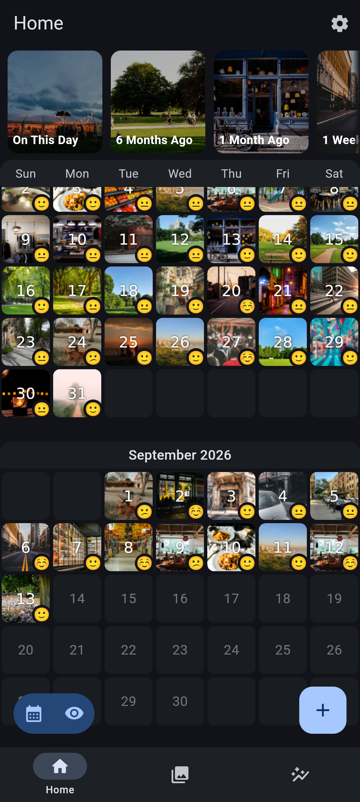
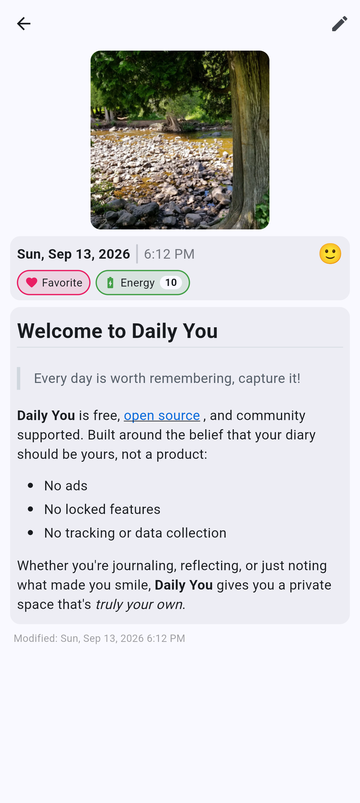

<h1 align="center">Daily You</h1>
<h2 align="center">Every day is worth remembering…</h2>
<h2 align="center">Fork of Demizo's Daily You with Windows Installer Linux Appimage and MacOS Package</h2>
<h3>Now on AUR (Archlinux), Flatpak, Snapcraft(Linux), and Chocolatey (Windows)</h3>
Capture the moments that matter. **Daily You** helps you log your thoughts, track your mood, and keep a diary of meaningful moments, every day. Whether you're journaling, reflecting, or just noting what made you smile, **Daily You** gives you a private space that's truly your own.

Join a community that believes **your journal should be yours**, not a product.

### Features

✍️ **Take daily logs:** Journal your thoughts, reflections, or routines.

📈 **Track your mood:** Gain insight into how your mood changes over time.

🖼️ **Keep photo memories:** Add pictures to enrich your memories.

📝 **Rich note taking:** Format notes your own way with Markdown.

🔔 **Gentle reminders:** Random daily nudges to keep you consistent.

🔒 **Control your data:** Choose where your data lives, including external storage.

🌐 **Offline-first:** Works without internet. Always.

**Daily You** is free, open source, and community supported. Built around the belief that your diary should be yours forever, not a subscription. No accounts, no ads, no locked features, and no tracking or data collection. Just your story, on your device, owned by you.

---

## Download

### Migrate From Another App
Are you coming from another app? Simply go to `Settings > Backup & Restore > Import From Another App` to import a backup from another app. Feel free to request any apps not currently listed. **Note:** Imports from some apps may not be one-to-one since **Daily You** may have different features.

### Development
The full development environment is defined using [Nix](https://nixos.org/). Simply, install the [Nix Package Manager](https://nixos.org/download/), clone the repository, enter the project directory, and run `nix develop`, that's it! Alternatively, **Daily You** is built using Flutter. You can directly [install Flutter](https://docs.flutter.dev/get-started/install), clone the repository, enter the project directory, and run `flutter pub get`.

---

  
## Support The App

**Daily You** is _free forever_ since everyone deserves a journal that is truly their own. If you find yourself enjoying the app, please consider supporting its continued development.

### Translations 
**Daily You** uses [Weblate](https://weblate.org) to easily manage translations. If you would like to help translate the app, please visit [the Daily You project on Weblate](https://hosted.weblate.org/projects/daily-you/). Everyone should have access to a journal!

## License
This software is free software licensed under the [GNU General Public License 3.0](LICENSE.txt). Additional terms under section 7 of that license apply; see [ADDITIONAL_TERMS.md](ADDITIONAL_TERMS.md).
