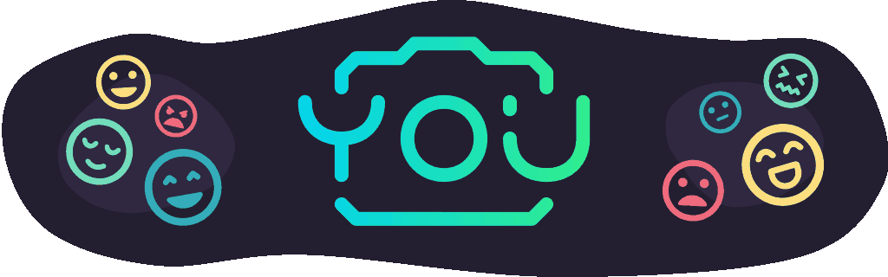
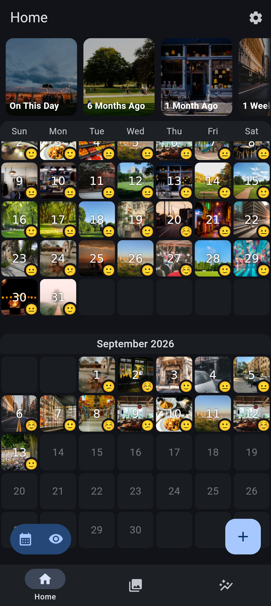
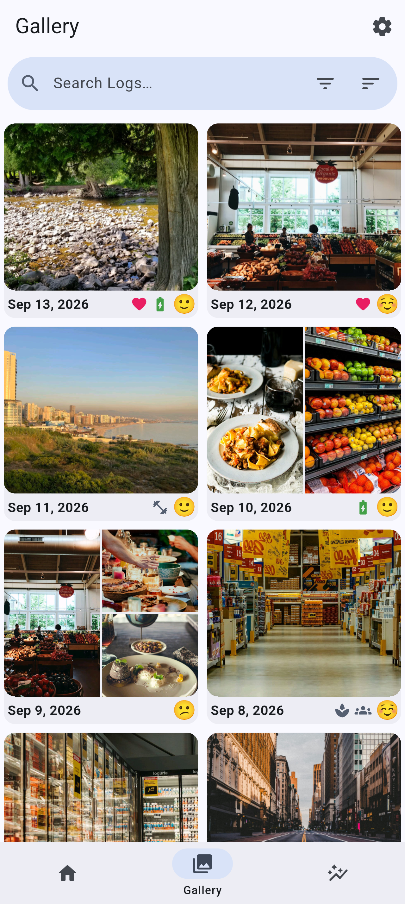
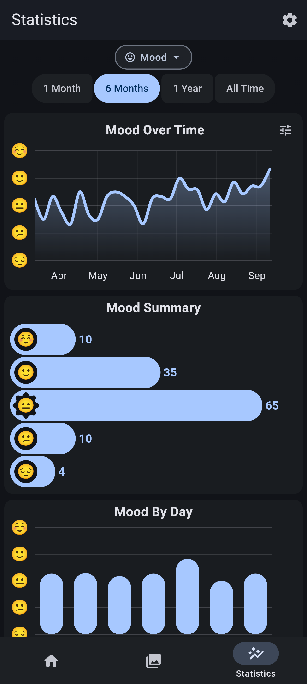
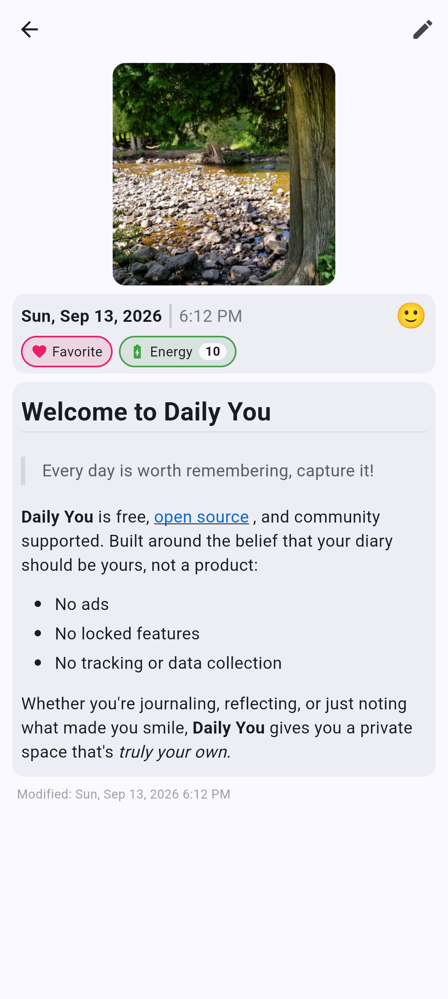
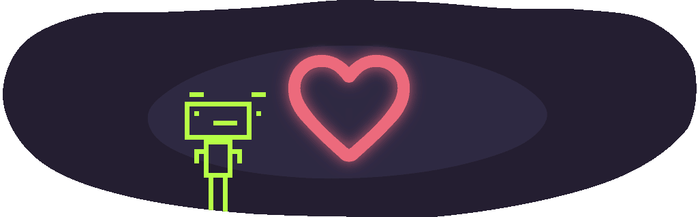

  
# Daily You

### Every day is worth remembering!

---

Your **private journal and mood tracker**. Daily You helps you capture your thoughts, photos, and mood over time. Enjoy a distraction-free diary with powerful tools and **NO paywalls, accounts, or subscriptions**.

Daily You is open-source and community-supported, built around the belief that **your journal should be yours**, not a product.

While **simple by default**, Daily You is packed with features:

- Add **photos**, video, audio, and other attachments
- Track your **mood** and see how it changes over time
- Set random or scheduled **reminders** to stay consistent
- Write rich notes with **text formatting** with Markdown support
- Organize with a robust **tag system** to keep track of anything
- Use advanced **search tools and statistics** to gain insights

---

---

Daily You **keeps your data safe**:

- No data is collected
- Encrypted backups and optional sync
- Set a password lock to protect your memories
- Works fully offline; you control where your data lives

Reflect on what matters most to you. People within the community use Daily You to track anxiety, stress, and general wellness. It can aid in therapy such as Cognitive Behavioral Therapy (CBT) and Interpersonal and Social Rhythm Therapy (IPSRT). No matter how you journal, Daily You helps you recognize achievements, trends, and connections between your mood and habits.

Join a community that believes _everyone should have access to a journal!_ Don't let your day get forgotten.

---

## Download

### Coming From Another App?
Daily You lets you import your existing journal. You can also export in a variety of formats so your data stays portable. If your prior app is not yet supported, feel free to request an import option! **Note:** Imports from some apps may not be one-to-one since Daily You may have different features.

### Development
The full development environment is defined using [Nix](https://nixos.org/). Simply, install the [Nix Package Manager](https://nixos.org/download/), clone the repository, enter the project directory, and run `nix develop`, that's it! Alternatively, **Daily You** is built using Flutter. You can directly [install Flutter](https://docs.flutter.dev/get-started/install), clone the repository, enter the project directory, and run `flutter pub get`.

---

  
## Support The App

Daily You is _free forever_ since everyone deserves a journal that is truly their own. If you find yourself enjoying the app, **please consider supporting its continued development.**

### Translations 
Daily You uses [Weblate](https://weblate.org) to easily manage translations. If you would like to help translate the app, please visit [the Daily You project on Weblate](https://hosted.weblate.org/projects/daily-you/). Everyone should have access to a journal!

## License
This software is free software licensed under the [GNU General Public License 3.0](LICENSE.txt). Additional terms under section 7 of that license apply; see [ADDITIONAL_TERMS.md](ADDITIONAL_TERMS.md).
