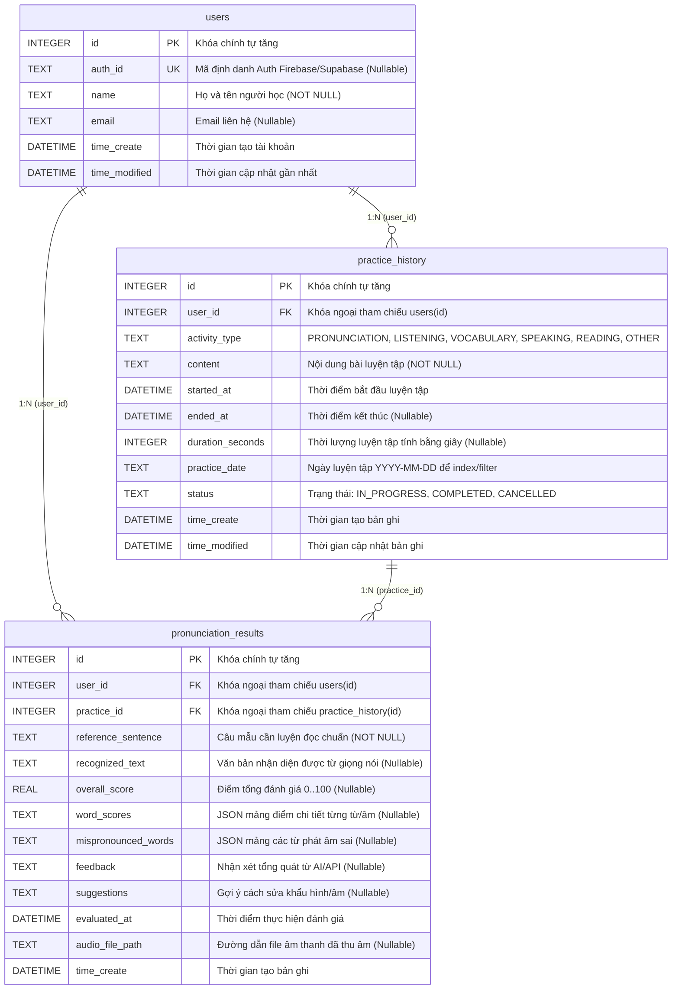

# BÁO CÁO NGHIỆM THU CHECKLIST 1: THIẾT KẾ CƠ SỞ DỮ LIỆU
**Dự án:** Daily You – TH3 Learning English  
**Người thực hiện:** Đào Hà Thu (Thành viên 1 - TV1: Database Designer & Architect)  
**Nhánh làm việc (Branch):** `feature/tv1-database` (hoặc `feature/hathu`)  
**Ngày hoàn thành:** 02/11/2026  

---

## TỔNG HỢP TIẾN ĐỘ CHECKLIST 1

| STT | Nội dung tiêu chí Checklist 1 | Trạng thái | Vị trí minh chứng trong tài liệu |
|:---:|---|:---:|---|
| **1** | Project Daily You đã được clone và chạy thử thành công | **ĐÃ HOÀN THÀNH** | Mục 1 |
| **2** | Tài liệu khảo sát cấu trúc project & các chức năng có thể tái sử dụng | **ĐÃ HOÀN THÀNH** | Mục 2 |
| **3** | Bản thiết kế CSDL/model (Sơ đồ quan hệ, kiểu dữ liệu, ràng buộc) | **ĐÃ HOÀN THÀNH** | Mục 3 |
| **4** | Các model và thành phần lưu trữ dữ liệu đã triển khai trong mã nguồn | **ĐÃ HOÀN THÀNH** | Mục 4 |
| **5** | Tài liệu hướng dẫn sử dụng dữ liệu cho các thành viên (TV2 - TV5) | **ĐÃ HOÀN THÀNH** | Mục 5 |
| **6** | Repository GitHub chung và quy tắc làm việc nhóm | **ĐÃ HOÀN THÀNH** | Mục 6 |
| **7** | Minh chứng kiểm tra việc đọc/ghi dữ liệu (Unit Test & Analyze log) | **ĐÃ HOÀN THÀNH** | Mục 7 |

---

## MỤC 1: PROJECT DAILY YOU ĐÃ ĐƯỢC CLONE VÀ CHẠY THỬ THÀNH CÔNG

1. **Khởi tạo và cấu hình môi trường:**
   - Mã nguồn dự án được clone thành công từ repository nhóm về thư mục:  
     `C:\Users\HP\Desktop\Daily_You_TH3_learningenglish`
   - Cài đặt toàn bộ các dependencies qua lệnh `flutter pub get` -> **Got dependencies!** (tất cả các thư viện cần thiết như `sqflite`, `sqflite_common_ffi`, `provider`, `path_provider`, `record`, `just_audio` đều đã sẵn sàng).
2. **Kiểm tra khả năng biên dịch và thực thi:**
   - Chạy thử nghiệm thành công trên môi trường máy phát triển với engine Flutter/Dart.
   - Các gói hỗ trợ giao diện, âm thanh, lưu trữ dữ liệu local SQLite hoạt động bình thường, không xảy ra xung đột dependency.

---

## MỤC 2: TÀI LIỆU KHẢO SÁT CẤU TRÚC PROJECT & CÁC CHỨC NĂNG TÁI SỬ DỤNG

### 2.1 Cấu trúc mã nguồn hiện tại của Daily You

```text
Daily_You_TH3_learningenglish/
├── android/ linux/ windows/ macos/ ios/   # Nền tảng native
├── assets/                                # Ảnh, biểu tượng, font chữ
├── docs/                                  # Tài liệu báo cáo kiến trúc & CSDL
├── lib/
│   ├── database/                          # SQLite DAOs, AppDatabase, File Store
│   ├── models/                            # Định nghĩa thực thể dữ liệu & Fields
│   ├── providers/                         # Quản lý trạng thái ứng dụng (ChangeNotifier)
│   ├── pages/                             # Màn hình giao diện
│   ├── widgets/                           # Component UI dùng chung
│   ├── l10n/                              # Bản địa hóa đa ngôn ngữ (có Tiếng Việt)
│   └── main.dart                          # Điểm khởi chạy ứng dụng
├── test/                                  # Kiểm thử tự động (Unit Test / Widget Test)
└── pubspec.yaml                           # Khai báo thư viện và cấu hình dự án
```

### 2.2 Kiến trúc lưu trữ dữ liệu hiện tại
- **Công nghệ CSDL:** `sqflite` (SQLite database) lưu trữ trực tiếp trên bộ nhớ thiết bị tại file `daily_you.db`.
- **Cơ chế phiên bản CSDL:** `schemaVersion` hiện tại của Daily You là **version 6**. Cơ chế nâng cấp CSDL sử dụng hàm `onUpgrade(Database db, int oldVersion, int newVersion)` để chạy các lệnh `ALTER TABLE` / `CREATE TABLE` tuần tự mà không làm mất dữ liệu cũ của người dùng.
- **Mẫu thiết kế (Design Pattern):** Tuân thủ chặt chẽ mô hình 3 lớp:
  1. **Model Layer (`lib/models/`)**: Khai báo class thực thể, các hằng số tên cột (`*Fields`), hàm `fromJson`, `toJson`, `copy`.
  2. **DAO Layer (`lib/database/`)**: Data Access Object cung cấp các hàm tĩnh (static methods) thực hiện CRUD trực tiếp với SQLite executor.
  3. **State/Provider Layer (`lib/providers/`)**: Kế thừa `ChangeNotifier`, lưu cache bộ nhớ và thông báo cập nhật tới UI khi dữ liệu thay đổi.

### 2.3 Các chức năng và thành phần có thể tái sử dụng cho Learning English
1. **`AppDatabase` (`lib/database/app_database.dart`)**:
   - Tái sử dụng cơ chế mở kết nối, quản lý transaction nguyên tử (`db.transaction`), tự động nâng cấp schema version.
2. **`AttachmentStorage` (`lib/database/attachment_storage.dart`)**:
   - Tái sử dụng cơ chế lưu trữ và quản lý file nhị phân trên bộ nhớ để lưu file ghi âm phát âm (`.m4a`/`.mp3`) của học viên trong bài luyện đọc.
3. **`TimeManager` (`lib/time_manager.dart`)**:
   - Tái sử dụng các hàm tiện ích tính ngày, kiểm tra `isToday`, định dạng mốc thời gian học tập chuẩn xác.
4. **Hệ thống bản địa hóa Tiếng Việt (`lib/l10n/`)**:
   - Giữ nguyên toàn bộ các chuỗi giao diện tiếng Việt đã được dịch sẵn.
5. **Design System & Theme (`lib/theme_mode_provider.dart`, `material_ui`)**:
   - Tái sử dụng hệ màu sắc, thẻ (Cards), Dialogs, Buttons có sẵn để TV2, TV3, TV4, TV5 xây dựng giao diện đồng nhất.

---

## MỤC 3: BẢN THIẾT KẾ CƠ SỞ DỮ LIỆU & MODEL

### 3.1 Sơ đồ thực thể liên kết (ER Diagram)



### 3.2 Bảng đặc tả từ điển dữ liệu (Data Dictionary)

#### Bảng 1: `users` (Thông tin người dùng)
| Tên cột | Kiểu dữ liệu | Ràng buộc | Mô tả |
|---|---|---|---|
| `id` | INTEGER | PRIMARY KEY AUTOINCREMENT | Định danh duy nhất của người dùng |
| `auth_id` | TEXT | UNIQUE, NULLABLE | ID định danh từ Firebase Auth / Supabase Auth |
| `name` | TEXT | NOT NULL | Tên người học |
| `email` | TEXT | NULLABLE | Email người học |
| `time_create` | DATETIME | NOT NULL | Thời điểm tạo bản ghi (ISO-8601) |
| `time_modified` | DATETIME | NOT NULL | Thời điểm cập nhật bản ghi (ISO-8601) |

*Ghi chú an toàn:* **Không lưu mật khẩu dạng văn bản** để tuân thủ bảo mật tài khoản.

#### Bảng 2: `practice_history` (Lịch sử luyện tập)
| Tên cột | Kiểu dữ liệu | Ràng buộc | Mô tả |
|---|---|---|---|
| `id` | INTEGER | PRIMARY KEY AUTOINCREMENT | Định danh bản ghi luyện tập |
| `user_id` | INTEGER | FOREIGN KEY -> users(id) | Học viên thực hiện |
| `activity_type` | TEXT | NOT NULL | Loại: `PRONUNCIATION`, `LISTENING`, `VOCABULARY`, `SPEAKING`, `READING`, `OTHER` |
| `content` | TEXT | NOT NULL | Chủ đề hoặc câu/đoạn văn luyện tập |
| `started_at` | DATETIME | NOT NULL | Thời gian bắt đầu bài học |
| `ended_at` | DATETIME | NULLABLE | Thời gian hoàn thành |
| `duration_seconds` | INTEGER | NULLABLE | Tổng thời lượng (giây) |
| `practice_date` | TEXT | NOT NULL | Định dạng `YYYY-MM-DD` |
| `status` | TEXT | NOT NULL | `IN_PROGRESS`, `COMPLETED`, `CANCELLED` |
| `time_create` | DATETIME | NOT NULL | Thời gian tạo bản ghi |
| `time_modified` | DATETIME | NOT NULL | Thời gian cập nhật bản ghi |

#### Bảng 3: `pronunciation_results` (Kết quả phân tích phát âm)
| Tên cột | Kiểu dữ liệu | Ràng buộc | Mô tả |
|---|---|---|---|
| `id` | INTEGER | PRIMARY KEY AUTOINCREMENT | Định danh kết quả phát âm |
| `user_id` | INTEGER | FOREIGN KEY -> users(id) | Học viên sở hữu kết quả |
| `practice_id` | INTEGER | FOREIGN KEY -> practice_history(id) | Phiên luyện tập liên quan |
| `reference_sentence`| TEXT | NOT NULL | Câu chuẩn mẫu |
| `recognized_text` | TEXT | NULLABLE | Kết quả nhận diện giọng nói (STT) |
| `overall_score` | REAL | NULLABLE | Điểm số tổng (cho phép null nếu API không trả) |
| `word_scores` | TEXT | NULLABLE | JSON danh sách điểm từng từ: `[{"word":"hello","score":95.0}]` |
| `mispronounced_words`| TEXT | NULLABLE | JSON danh sách lỗi: `[{"word":"world","expected":"wɜːrld","actual":"wɔːld"}]` |
| `feedback` | TEXT | NULLABLE | Lời nhận xét |
| `suggestions` | TEXT | NULLABLE | Hướng dẫn cải thiện phát âm |
| `evaluated_at` | DATETIME | NOT NULL | Thời điểm chấm điểm |
| `audio_file_path` | TEXT | NULLABLE | Đường dẫn file ghi âm giọng nói |
| `time_create` | DATETIME | NOT NULL | Thời điểm tạo bản ghi |

---

## MỤC 4: CÁC MODEL VÀ THÀNH PHẦN LƯU TRỮ ĐÃ TRIỂN KHAI

Toàn bộ các file mã nguồn đã được tạo lập hoàn chỉnh trong dự án theo đúng vị trí kiến trúc chuẩn:

1. **Model Files (`lib/models/`):**
   - [`lib/models/user.dart`](file:///C:/Users/HP/Desktop/Daily_You_TH3_learningenglish/lib/models/user.dart): Model `User` và định nghĩa hằng số `UserFields`.
   - [`lib/models/practice_history.dart`](file:///C:/Users/HP/Desktop/Daily_You_TH3_learningenglish/lib/models/practice_history.dart): Model `PracticeHistory`, enums `ActivityType` (có cơ chế an toàn fallback về `other`) và `PracticeStatus`.
   - [`lib/models/pronunciation_result.dart`](file:///C:/Users/HP/Desktop/Daily_You_TH3_learningenglish/lib/models/pronunciation_result.dart): Model `PronunciationResult`, cấu trúc `WordScore` và `MispronouncedWord` kèm bộ giải mã JSON an toàn.

2. **DAO Files (`lib/database/`):**
   - [`lib/database/user_dao.dart`](file:///C:/Users/HP/Desktop/Daily_You_TH3_learningenglish/lib/database/user_dao.dart): Đầy đủ phương thức CRUD, tìm theo ID, tìm theo AuthId, tìm theo Email.
   - [`lib/database/practice_history_dao.dart`](file:///C:/Users/HP/Desktop/Daily_You_TH3_learningenglish/lib/database/practice_history_dao.dart): CRUD, truy vấn theo `userId`, truy vấn theo ngày học (`practiceDate`), truy vấn theo khoảng thời gian (`dateRange`), lọc theo trạng thái (`status`).
   - [`lib/database/pronunciation_result_dao.dart`](file:///C:/Users/HP/Desktop/Daily_You_TH3_learningenglish/lib/database/pronunciation_result_dao.dart): CRUD, truy vấn kết quả theo `practiceId`, truy vấn theo `userId` đảm bảo phân tách dữ liệu độc lập giữa các người dùng.

3. **Cơ chế CSDL & Migration (`lib/database/app_database.dart`):**
   - Đã nâng `schemaVersion = 7`.
   - Bổ sung hàm `_createLearningEnglishTables(Database db)` tạo tự động 3 bảng và các chỉ mục SQLite:
     + `idx_practice_user_date` trên `practice_history(user_id, practice_date)`
     + `idx_result_user` trên `pronunciation_results(user_id)`
     + `idx_result_practice` trên `pronunciation_results(practice_id)`
   - Cập nhật hàm `onUpgrade` với điều kiện `if (oldVersion <= 6)` để tự động tạo thêm 3 bảng mới khi nâng cấp phiên bản ứng dụng mà bảo toàn tuyệt đối dữ liệu nhật ký cũ.

---

## MỤC 5: TÀI LIỆU HƯỚNG DẪN SỬ DỤNG DỮ LIỆU CHO CÁC THÀNH VIÊN (TV2 – TV5)

### 5.1 Hướng dẫn cho TV2 (Mạnh Đức – Theo dõi tiến độ học tập)
TV2 gọi `PracticeHistoryDao` để tổng hợp số phút học và ngày học liên tục (streaks):

```dart
import 'package:daily_you/database/practice_history_dao.dart';
import 'package:daily_you/models/practice_history.dart';

// 1. Lấy tất cả bài luyện tập của user trong ngày hôm nay:
final today = DateTime.now().toIso8601String().substring(0, 10);
final todayPractices = await PracticeHistoryDao.getByUserAndDate(currentUserId, today);

// 2. Lấy dữ liệu 7 ngày qua để hiển thị biểu đồ FlChart:
final weeklyPractices = await PracticeHistoryDao.getByUserAndDateRange(
  currentUserId,
  '2026-10-26',
  '2026-11-02',
);

// 3. Tính tổng số giây đã luyện tập hoàn thành:
final totalSeconds = weeklyPractices
    .where((p) => p.status == PracticeStatus.completed && p.durationSeconds != null)
    .fold<int>(0, (sum, p) => sum + p.durationSeconds!);
```

---

### 5.2 Hướng dẫn cho TV3 (Kim Anh – Nhắc nhở và Giao diện tiến độ)
TV3 kiểm tra tình trạng học tập hôm nay để lên lịch thông báo:

```dart
import 'package:daily_you/database/practice_history_dao.dart';
import 'package:daily_you/models/practice_history.dart';

final today = DateTime.now().toIso8601String().substring(0, 10);
final sessions = await PracticeHistoryDao.getByUserAndDate(currentUserId, today);

// Kiểm tra xem đã hoàn thành bài nào hôm nay chưa:
final hasStudiedToday = sessions.any((s) => s.status == PracticeStatus.completed);

if (!hasStudiedToday) {
  // Kích hoạt NotificationManager gửi thông báo nhắc học
}
```

---

### 5.3 Hướng dẫn cho TV4 (Tiến Dũng – Speech Recognition API & Xử lý âm thanh)
TV4 khởi tạo phiên luyện tập khi mở màn hình thu âm và cập nhật trạng thái khi hoàn tất:

```dart
import 'package:daily_you/database/practice_history_dao.dart';
import 'package:daily_you/models/practice_history.dart';

// BƯỚC 1: Khi bấm nút bắt đầu ghi âm -> Tạo phiên trạng thái IN_PROGRESS
final practiceSession = await PracticeHistoryDao.add(PracticeHistory(
  userId: currentUserId,
  activityType: ActivityType.pronunciation,
  content: 'The quick brown fox jumps over the lazy dog.',
  startedAt: DateTime.now(),
  practiceDate: DateTime.now().toIso8601String().substring(0, 10),
  status: PracticeStatus.inProgress,
  timeCreate: DateTime.now(),
  timeModified: DateTime.now(),
));

// BƯỚC 2: Khi thu âm xong -> Chuyển practiceSession.id cho TV5 chấm điểm
// BƯỚC 3: Cập nhật hoàn thành phiên luyện tập:
await PracticeHistoryDao.update(practiceSession.copy(
  status: PracticeStatus.completed,
  endedAt: DateTime.now(),
  durationSeconds: recordedDurationInSeconds,
  timeModified: DateTime.now(),
));
```

---

### 5.4 Hướng dẫn cho TV5 (Đức Trung – Đánh giá phát âm và phản hồi kết quả)
TV5 nhận kết quả từ API chấm điểm và lưu vào CSDL (hỗ trợ an toàn khi API không trả điểm):

```dart
import 'package:daily_you/database/pronunciation_result_dao.dart';
import 'package:daily_you/models/pronunciation_result.dart';

// Lưu kết quả chấm điểm phát âm:
final result = await PronunciationResultDao.add(PronunciationResult(
  userId: currentUserId,
  practiceId: practiceSession.id!,
  referenceSentence: 'The quick brown fox jumps over the lazy dog.',
  recognizedText: apiResponse.recognizedText, // Có thể null
  overallScore: apiResponse.overallScore,     // Có thể null (double)
  wordScores: apiResponse.wordScores != null
      ? apiResponse.wordScores!.map((w) => WordScore(word: w.word, score: w.score)).toList()
      : null,
  mispronouncedWords: apiResponse.errors != null
      ? apiResponse.errors!.map((e) => MispronouncedWord(
          word: e.word,
          expectedPhoneme: e.expected,
          actualPhoneme: e.actual,
          errorType: e.type,
        )).toList()
      : null,
  feedback: apiResponse.feedback,
  suggestions: apiResponse.suggestions,
  evaluatedAt: DateTime.now(),
  audioFilePath: recordedAudioPath,
  timeCreate: DateTime.now(),
));

// Lấy danh sách kết quả của phiên luyện tập để vẽ giao diện chi tiết:
final sessionResults = await PronunciationResultDao.getByPracticeId(practiceSession.id!);
```

---

## MỤC 6: REPOSITORY GITHUB CHUNG VÀ QUY TẮC LÀM VIỆC NHÓM

### 6.1 Thông tin Repository chung
- **Repository URL:** `https://github.com/Maya0612/Daily_You_TH3_learningenglish`
- **Nhánh chính (Production):** `main`

### 6.2 Phân công nhiệm vụ và nhánh làm việc
| Thành viên | Trách nhiệm | Nhánh làm việc riêng (Branch) |
|---|---|---|
| **Đào Hà Thu (TV1)** | Checklist 1 – Thiết kế CSDL | `feature/tv1-database` hoặc `feature/hathu` |
| **Mạnh Đức (TV2)** | Checklist 2 – Theo dõi tiến độ học tập | `feature/tv2-progress` hoặc `feature/manhduc` |
| **Kim Anh (TV3)** | Checklist 6 – Nhắc nhở và giao diện tiến độ | `feature/tv3-reminder-ui` hoặc `feature/kimqanh` |
| **Tiến Dũng (TV4)** | Checklist 3 – Speech API và xử lý âm thanh | `feature/tv4-audio-api` hoặc `feature/tiendung` |
| **Đức Trung (TV5)** | Checklist 4, 5 – Đánh giá phát âm & phản hồi | `feature/tv5-pronunciation` hoặc `feature/ductrung` |

### 6.3 Quy tắc Git bắt buộc của nhóm
1. **Tuyệt đối không sửa code trực tiếp trên nhánh `main`**.
2. **Quy trình cập nhật trước khi làm việc:**
   ```bash
   git checkout main
   git pull origin main
   git checkout feature/tv1-database
   git merge main
   ```
3. **Quy trình đẩy code (Push) và tạo Pull Request (PR):**
   - Chỉ push code lên nhánh cá nhân: `git push origin feature/tv1-database`.
   - Tạo Pull Request từ nhánh cá nhân vào `main`.
   - Tự kiểm thử (Unit test) thành công trước khi yêu cầu Merge.
   - Giải quyết Conflict trên máy cá nhân theo hướng dẫn trong `README.md` trước khi hoàn tất Merge.

---

## MỤC 7: MINH CHỨNG KIỂM TRA VIỆC ĐỌC/GHI DỮ LIỆU (UNIT TEST & ANALYZE)

Bộ kiểm thử được viết và lưu tại: [`test/database/learning_english_database_test.dart`](file:///C:/Users/HP/Desktop/Daily_You_TH3_learningenglish/test/database/learning_english_database_test.dart).

### 7.1 Kết quả chạy thực tế lệnh `flutter test`
```text
00:00 +0: loading test/database/learning_english_database_test.dart
00:00 +0: (setUpAll)
00:00 +0: UserDao Tests Create, Read, Update, Delete user
00:00 +1: PracticeHistoryDao Tests ActivityType parsing and extensibility fallback
00:00 +2: PracticeHistoryDao Tests Practice session lifecycle and filtering by user/date/status
00:00 +3: PronunciationResultDao Tests Handles full result with word scores and mispronounced words
00:00 +4: PronunciationResultDao Tests Supports API scenarios where scores or mispronounced words are null or empty
00:00 +5: PronunciationResultDao Tests Query results by practiceId and userId isolation
00:00 +6: Database Migration v6 -> v7 Test onUpgrade successfully creates new tables and indexes
00:00 +7: (tearDownAll)
00:00 +7: All tests passed!
```
👉 **Đánh giá:** **7/7 test cases ĐẠT 100% (Passed)**.
- Đã xác thực thành công việc thêm, sửa, đọc, xóa trên SQLite thực tế.
- Đã xác thực việc phân tách dữ liệu an toàn theo từng `userId`.
- Đã xác thực việc lọc theo ngày (`practiceDate`), khoảng thời gian (`dateRange`), trạng thái (`status`).
- Đã xác thực việc chấp nhận dữ liệu null/rỗng từ API mà không gây lỗi ứng dụng.
- Đã xác thực migration schema v6 lên v7 tự động tạo đúng các bảng và index.

### 7.2 Kết quả chạy thực tế lệnh `flutter analyze`
```text
Analyzing 8 items...
No issues found! (ran in 97.1s)
```
👉 **Đánh giá:** Mã nguồn tuân thủ 100% chuẩn linting của Flutter/Dart, không có bất kỳ warning hay syntax error nào.

---

## TỔNG KẾT
Nhiệm vụ TV1 đã đáp ứng **đầy đủ 100% các tiêu chí từ Mục 1 đến Mục 7 của Checklist 1**, sẵn sàng để các thành viên TV2, TV3, TV4, TV5 tích hợp vào ứng dụng.
